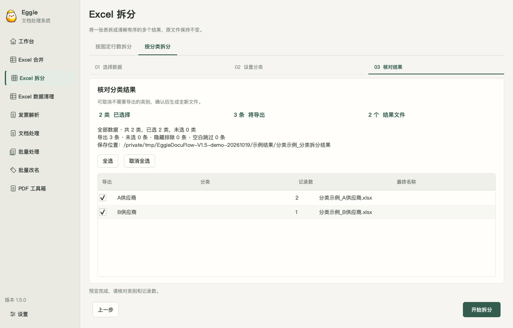
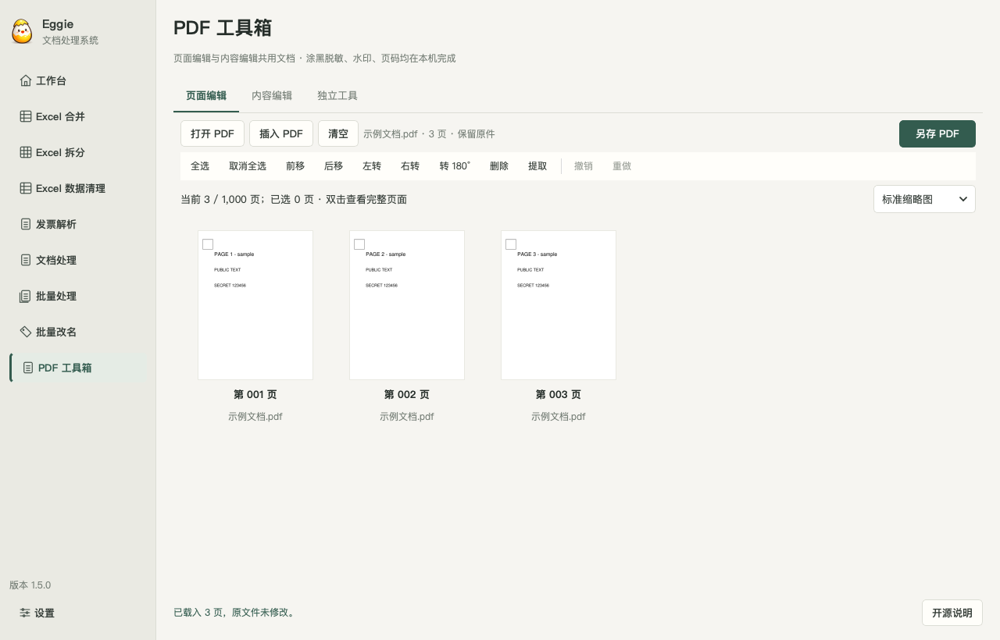
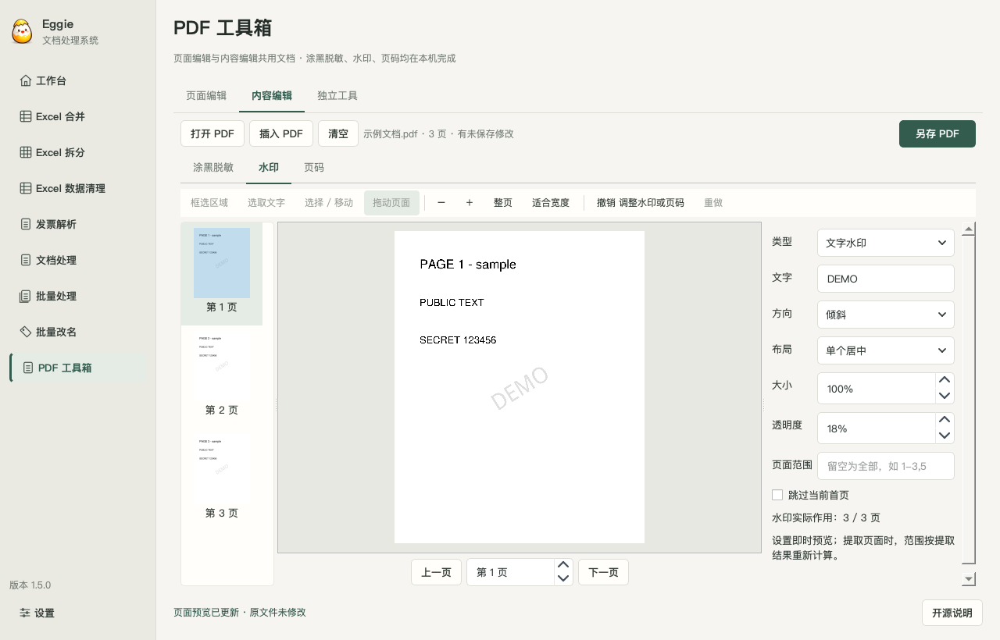

# Eggie DocuFlow｜免费的 Excel 与 PDF 桌面处理工具


免费的 Excel、PDF 与文件处理工具，无需安装 Python。支持 Excel 合并、拆分与清理，PDF 编辑、发票解析和批量改名。<br>
A free desktop toolkit for Excel, PDF and file workflows. Merge, split and clean Excel files, edit PDFs, extract invoice data and rename files in batches. No Python installation required.

## 下载 V1.5.0 / Download V1.5.0

<!-- v1.5-upload-status:start -->
V1.5.0 下载暂未开放，安装包上传完成后会在[发布页](https://github.com/huangchong-4806/Eggie-DocuFlow/releases)开放。下方保留 V1.4.0 下载入口。<br>
V1.5.0 downloads are not yet available. Once uploaded, the installers will be listed on the [Releases page](https://github.com/huangchong-4806/Eggie-DocuFlow/releases). V1.4.0 downloads remain available below.
<!-- v1.5-upload-status:end -->

- **Mac**：Apple 芯片，macOS 15 及以上。 / Apple silicon, macOS 15 or later.
- **Windows**：Windows 10/11，64 位。 / Windows 10/11, 64-bit.
- 无需安装 Python。 / No Python installation required.

[V1.5.0 更新说明 / Release notes](release_notes_v1.5.0.md)

Excel 与 PDF 默认在本机处理并另存结果；文件改名先预览再执行。只有主动配置、启用并确认云 OCR 后，扫描页才会发送给所选服务商。<br>
Excel and PDF processing runs locally and saves new output files. File renaming requires a preview first. Scanned pages are sent to the selected cloud OCR provider only after configuration, opt-in and confirmation.

## V1.5.0 主要变化 / What's new in V1.5.0

- **Excel 按类别拆分 / Split Excel by category**：按一列或多列分类，选择“每类一个文件”或“每类一个工作表”；后者保存在同一个新 Excel 文件中。原有按固定行数拆分继续保留。<br>
  Group rows by one or more columns, then save each group as a separate file or as a separate worksheet in one new workbook. Fixed-row splitting remains available.
- **拆分前预览 / Preview before splitting**：先查看类别、记录数和结果名称；遇到筛选或隐藏行时，可选择处理全部数据或仅可见行。分类拆分将公式转为源文件已保存的计算结果。<br>
  Review groups, row counts and output names first. Choose all rows or visible rows when filters or hidden rows are detected. Category splitting uses saved formula values.
- **PDF 页面编辑 / PDF page editing**：支持插入、删除、拖动排序、旋转和提取页面，并可撤销、重做。<br>
  Insert, delete, reorder, rotate and extract pages, with undo and redo.
- **PDF 内容处理 / PDF content tools**：支持区域或文字涂黑、文字与图片水印，以及页码样式、位置和页范围设置。<br>
  Redact selected areas or text, add text or image watermarks, and customize page-number style, position and page ranges.
- **界面与使用体验 / Interface and usability**：更新首页和工具页布局，简化操作文字；修复图片预览、转换按钮、保存位置，以及 Excel 长编号和引用处理等问题。<br>
  Updated home and tool layouts, clearer labels, and fixes for image previews, conversion buttons, save locations, long Excel identifiers and cell references.

## 历史版本 / Previous release

- [V1.4.0 Mac：Apple 芯片 / Apple silicon](https://github.com/huangchong-4806/Eggie-DocuFlow/releases/download/v1.4.0/EggieDocuFlow_V1.4.0_mac.zip)
- [V1.4.0 Windows：Windows 10/11，64 位 / 64-bit](https://github.com/huangchong-4806/Eggie-DocuFlow/releases/download/v1.4.0/EggieDocuFlow_V1.4.0_Windows_x64_Setup.exe)

V1.4.0 的 Mac 系统要求为 macOS 11 及以上；V1.5.0 的 Mac 系统要求为 macOS 15 及以上。<br>
The V1.4.0 Mac release requires macOS 11 or later; V1.5.0 requires macOS 15 or later.

开源许可和第三方声明见 [THIRD_PARTY_NOTICES.md](THIRD_PARTY_NOTICES.md)。保留原 MIT 授权与署名，包含 PyMuPDF / MuPDF 的组合应用按 AGPLv3 分发。<br>
See [THIRD_PARTY_NOTICES.md](THIRD_PARTY_NOTICES.md) for licensing and third-party notices. Original MIT notices are retained; the combined application including PyMuPDF / MuPDF is distributed under AGPLv3.

## 功能概览 / Features Overview

Eggie DocuFlow 是一个面向日常办公场景的 Excel、PDF 与文件处理工具。当前版本支持
Excel 合并、拆分与数据清理、PDF 发票解析、文档智能处理、PDF 文件夹批量处理、智能改名，以及 PDF 工具箱。

当前版本重点解决以下问题：

- 多个 Excel 文件批量合并
- 按文件列表顺序合并
- 尽量保留原始单元格格式、列宽、合并单元格和公式
- 按固定行数或一列、多列内容分类拆分 Excel 文件
- 拆分文件自动保留指定表头
- 拆分结果自动集中保存到独立文件夹
- Excel 数据清理支持空白行、文字空格、重复数据和日期数字格式预览
- PDF 发票转换为财务结构化 Excel，并自动校验金额与税额
- PDF 文档智能路由：自动识别发票、合同、表格和未知文档
- 文档处理内可选接入用户自备的百度智能云或阿里云 OCR 密钥
- 可复制文字的 PDF 页仅在本机读取，仅扫描页在用户确认后调用云 OCR
- 可单独导出文字、保留页码与位置的 JSON 以及不包含密钥和正文的处理日志
- 批量处理中心可扫描文件夹、逐份预览、失败继续并单独重试失败文件
- 合同 PDF 输出 Word 文档，表格 PDF 输出 Excel，未知 PDF 输出文本说明
- 文档智能处理支持增强排版转换，合同可套正式样式并还原附件表格，表格可保留边框和版式
- 批量改名工具支持先预览再执行，支持替换、删除、追加、改后缀、删除开头或结尾文字
- 改名预览出现空白文件名时会弹窗提醒并阻止执行
- 智能改名可从发票或合同中生成名称建议，并标记内容完全相同的文件
- PDF 页面与内容编辑支持插入、排序、旋转、提取、撤销与重做，以及涂黑、文字与图片水印和页码
- PDF 独立工具提供合并、压缩、图片转换、打开密码、可搜索 PDF 和文字对比
- 文件和文件夹选择会记住上次打开位置
- 图片转 PDF 会自动过滤非图片或无法读取的文件
- 支持较大文件的低内存处理
- 提供简单易用的 macOS 与 Windows 图形界面

Eggie DocuFlow is a desktop utility for everyday office workflows. It supports
Excel merging, Excel splitting, structured parsing of text-based PDF invoices,
intelligent PDF document routing, batch file renaming, and PDF toolbox workflows.

The current release focuses on:

- Batch merging multiple Excel files
- Merging files in the order shown in the file list
- Preserving cell styles, column widths, merged cells, and formulas whenever possible
- Splitting Excel files by a custom number of data rows or by values in one or more columns
- Keeping the configured header rows in every split file
- Saving split output files into an automatically created folder
- Previewing Excel cleanup for blank rows, text spaces, duplicate data, and date/number display formats
- Converting PDF invoices into finance-ready Excel files with amount and tax validation
- Intelligent PDF routing for invoices, contracts, tables, and unknown documents
- Optional Baidu or Alibaba Cloud OCR using the user's own credentials
- Reading text-based PDF pages locally and sending scanned pages to cloud OCR only after confirmation
- Exporting text, page/position JSON, and diagnostic logs without credentials or document body text
- Folder-based PDF batch processing with per-file previews, continued processing after failures, and retrying failed files
- Exporting contracts to Word, tables to Excel, and unknown PDFs to text reports
- Enhanced document layout conversion for formal contracts and table-like PDFs
- Batch file renaming with preview-first execution
- Safe warnings when a rename rule would create blank filenames
- Suggesting filenames from invoices or contracts and identifying files with identical content
- PDF page and content editing with insert, reorder, rotate, extract, undo/redo, redaction, text/image watermarks and page numbering
- Independent PDF tools for merge, compression, image conversion, passwords, searchable PDFs and text comparison
- File and folder dialogs remember the last used location
- Images-to-PDF skips unsupported or unreadable files automatically
- Low-memory processing for larger workbooks
- Simple and user-friendly macOS and Windows graphical interfaces

## 安装与首次打开说明 / Installation Notes

如果你只是想直接使用软件，不需要安装 Python，也不需要运行源码。

1. Mac：下载V1.5.0 ZIP，解压后将 `Eggie DocuFlow.app` 放入“应用程序”目录。旧版V1.4.0的应用名为 `EggieDocuFlow_V1.4.0_mac.app`。
2. Windows：下载安装包并运行 `EggieDocuFlow_V1.5.0_Windows_x64_Setup.exe`，完成安装后从桌面或开始菜单打开软件

If you only want to use the application, you do not need to install Python or
run the source code.

1. On macOS, extract the V1.5.0 ZIP and place `Eggie DocuFlow.app` in Applications.
2. On Windows, run `EggieDocuFlow_V1.5.0_Windows_x64_Setup.exe`, then launch the app from the desktop or Start menu

> Windows 版支持 Windows 10/11 64 位系统；安装程序默认安装到 `C:\Program Files\Eggie DocuFlow`，安装时会请求 Windows 管理员授权，并提供标准卸载入口。
> The Windows build supports 64-bit Windows 10/11. It installs to `C:\Program Files\Eggie DocuFlow` by default, requests Windows administrator approval during setup, and includes a standard uninstall entry.

## 软件界面 / Screenshots

以下为 V1.5.0 中文界面。 / The screenshots below show the V1.5.0 Chinese interface.

### 首页 / Home


### Excel 分类拆分 / Excel category splitting



### PDF 页面编辑 / PDF page editing



### PDF 内容编辑 / PDF content editing



<details>
<summary>其他工具界面 / More tool screenshots</summary>

#### Excel 合并 / Excel merge


#### 按行数拆分 / Split by row count


#### 数据清理 / Data cleanup


#### 发票解析 / Invoice extraction


#### 文档智能处理 / Document processing


#### PDF 批量处理 / PDF batch processing


#### 批量改名 / Batch rename


</details>

## 主要功能 / Features

### Excel 合并 / Excel Merge

- 添加单个文件或递归添加整个文件夹 / Add individual files or recursively add an entire folder
- 通过“上移 / 下移”按钮调整合并顺序 / Reorder files with the **Move Up / Move Down** buttons
- 后续文件可跳过 `0-99` 行表头 / Skip `0-99` header rows in subsequent files
- 自动保留字体、填充、边框、对齐、数字格式和保护设置 / Preserve fonts, fills, borders, alignment, number formats, and protection settings
- 自动调整复制后的公式引用 / Adjust copied formula references automatically
- 可选择是否保留合并单元格 / Choose whether to preserve merged cells
- 保存窗口跟随 macOS 系统语言 / Use the macOS system language in the save dialog
- 普通工作簿使用低内存流式合并，复杂合并单元格自动切换兼容模式 / Use low-memory streaming for standard workbooks and compatibility mode for complex merged cells

### Excel 拆分 / Excel Split

V1.5.0 分类模式：选择 `.xlsx` 文件、工作表、数据范围及表头行数 → 选择一列或多列作为分类依据 → 选择“每类一个文件”或“每类一个工作表” → 预览类别和行数 → 核对提示后执行。“每类一个工作表”保存在同一个新 Excel 文件中。原有按行数拆分仍可使用。<br>
In V1.5.0 category mode, select an `.xlsx` file, worksheet, range and header rows, then choose grouping columns and an output format. Review the categories and row counts before confirming. Each category can become a separate file or a separate sheet in one new workbook. Fixed-row splitting remains available.

分类模式默认处理全部数据；发现筛选或隐藏行时可切换为仅可见行。公式只使用文件里已保存的计算结果，不在本软件内重新计算；缺少结果或无法安全处理的复杂内容会阻止执行。请先在 Excel 中计算并保存源文件。输出只生成新文件，不向原工作簿追加结果。<br>
Category mode includes all rows by default and offers visible rows only when filters or hidden rows are found. Formulas use saved results and are not recalculated. Missing results or unsupported complex content block processing. Recalculate and save the source in Excel first. Outputs are new files; nothing is appended to the original workbook.

以下为原有按固定行数拆分说明：<br>
Fixed-row splitting:

- 新增 Excel 拆分工具 / Added a new Excel split tool
- 支持选择 Excel 文件进行拆分 / Users can select an Excel file to split
- 支持设置表头行数 / Users can configure the number of header rows
- 支持设置每个文件的数据行数 / Users can split an Excel file by a custom number of data rows
- 拆分行数不包含表头 / The split row count does not include header rows
- 每个拆分文件都会自动带上表头 / Each output file keeps the configured header rows
- 自动创建“原文件名_拆分结果”文件夹 / Output files are saved into an automatically created folder
- 拆分文件命名规则为“原文件名_拆分001.xlsx” / Split files are named like `原文件名_拆分001.xlsx`
- 优化了大文件拆分速度 / Large-file splitting performance has been improved
- 原始 Excel 文件只读取，不会被修改 / The original Excel file is read-only and will not be modified

### Excel 数据清理 / Excel Cleanup

- 选择工作表和表头行后，先预览将删除的空白行、空格和重复行 / Preview blank rows, extra spaces, and duplicate rows before cleanup
- 可按指定列判断重复数据 / Choose which columns determine duplicate rows
- 只为已有日期和数字数据统一显示格式，不改变实际数值 / Normalize display formats without changing stored values
- 源文件不变，始终生成新文件和详细日志 / Always creates a new workbook and a detailed log

### PDF发票解析工具 / PDF Invoice Parser

- 支持 100 页以内、可复制文字的 PDF 发票 / Supports text-based PDF invoices up to 100 pages
- 支持一次选择多个 PDF，每票独立生成 Excel / Supports multiple PDFs with one Excel output per invoice
- 单票失败不影响其他发票，并在完成后汇总失败原因 / A failed invoice does not stop the batch and is reported at completion
- 统一输出发票头信息、明细表和校验结果 / Outputs header, item, and validation sheets
- 校验数量与单价、金额与税额、价税合计 / Validates quantities, prices, amounts, taxes, and totals
- 不输出 PDF 原始逐行文本 / Never exports raw line-by-line PDF text

### 文档智能处理 / Document Intelligence

- 从“文档处理”进入，自动识别 PDF 类型并生成对应结果 / Open **Document Processing** to classify PDFs and create the corresponding output
- 支持选择或拖拽 PDF 文件 / Supports selecting or dragging a PDF file
- 自动分类为发票、合同、表格或未知文档 / Automatically classifies invoices, contracts, tables, or unknown documents
- 发票复用原有发票解析逻辑并输出 Excel / Invoices reuse the existing invoice parser and export Excel
- 合同输出 Word 文档 / Contracts export Word documents
- 表格类 PDF 输出标准 Excel / Table-like PDFs export standard Excel workbooks
- 可勾选“增强排版转换”，由系统自动判断合同或表格后套用增强版式 / Users can enable enhanced layout conversion while the app still classifies the PDF automatically
- 合同增强模式会套正式合同样式，并尽量还原附件表格 / Enhanced contract conversion applies a formal contract style and restores attachment tables where possible
- 表格增强模式会尽量保留边框、列宽和行高 / Enhanced table conversion preserves borders, column widths, and row heights where possible
- 扫描件默认不启用 OCR，会输出 UNKNOWN 文本说明 / Scanned PDFs use the original UNKNOWN text result while cloud OCR is disabled
- 可在当前页面勾选“扫描页使用云端文字识别”，使用用户自己申请的百度或阿里云密钥 / Optional user-supplied Baidu or Alibaba Cloud OCR credentials are integrated into the same page
- 不勾选云 OCR 时，原有处理流程不变 / The original document workflow remains unchanged when cloud OCR is disabled
- 可在同一页面点击“仅提取文字”，生成 TXT、JSON 和排查日志 / Text-only extraction creates TXT, JSON, and diagnostic log outputs

### 批量处理中心 / Batch Processing Center

- 扫描文件夹中的 PDF，可选是否包含子文件夹 / Scan PDFs in one folder with optional subfolder support
- 开始前显示页数、扫描页数和建议处理方式 / Preview pages, scanned pages, and suggested processing before starting
- 单个文件失败不影响后续文件，可只重试失败项 / Continue after individual failures and retry failed files only
- 扫描页只有在用户配置密钥并确认页码后才会发送给所选 OCR 平台 / Send scanned pages to OCR only after credential setup and explicit confirmation

### 批量改名 / Batch Rename

- 保留原有查找替换、删除、前后缀和编号规则 / Keeps the existing replace, delete, prefix, suffix, and numbering rules
- 新增智能识别命名，可根据发票或合同内容生成建议文件名 / Suggest names from invoice or contract content
- 按文件内容检查重复项，只标记不自动删除 / Detect exact duplicates without deleting files
- 所有改名仍需先预览，重名、空名和目标已存在时会阻止执行 / Preview-first execution blocks unsafe rename results

### PDF 工具箱 / PDF Toolbox

- 页面整理支持缩略图拖拽排序 / Page organizer supports thumbnail drag-and-drop ordering
- 支持多选页面后旋转、删除或拆分导出 / Supports multi-select page rotation, deletion, and split export
- 支持多个 PDF 合并，并可修改默认输出文件名 / Supports merging PDFs with editable output filenames
- 支持三档安全压缩 PDF，并显示预计压缩后大小和预计缩小比例 / Safely compresses PDFs with three presets and estimated size reduction
- 支持多张图片合成 PDF / Converts multiple images into one PDF
- 支持 PDF 每页导出 PNG 或 JPG 图片 / Exports each PDF page as PNG or JPG images
- 图片转 PDF 支持缩略图预览、拖拽排序、双击放大和自动过滤非图片文件 / Images-to-PDF supports thumbnail preview, drag ordering, double-click preview, and automatic non-image filtering
- 支持区域与文字涂黑、文字与图片水印，以及可设置样式、位置和起始数字的页码 / Supports area/text redaction, text/image watermarks and page numbers with configurable style, position and starting value
- 支持设置 PDF 打开密码，或在已知原密码时生成无密码副本 / Sets or removes PDF open passwords when the original password is known
- 为扫描页生成可搜索文字层，保留原页面图像 / Creates searchable text layers while preserving scanned-page images
- 将两份可搜索 PDF 的文字差异生成本机 HTML 报告 / Builds a local HTML text-difference report for two searchable PDFs

## 使用方法 / Usage

1. 从桌面、开始菜单或 Mac 应用程序中打开 Eggie DocuFlow。 / Launch Eggie DocuFlow from the desktop, Start menu, or macOS Applications.
2. 选择需要使用的工具。 / Choose the tool you need.

合并 Excel： / Merge Excel:

1. 添加 Excel 文件或包含 Excel 文件的文件夹。 / Add Excel files or a folder containing Excel files.
2. 使用“上移 / 下移”确认文件顺序。 / Confirm the merge order with **Move Up / Move Down**.
3. 设置后续文件跳过的行数。 / Set the number of rows to skip in subsequent files.
4. 选择输出文件位置并点击“开始合并”。 / Choose an output location and click **Start Merge**.

拆分 Excel： / Split Excel:

1. 进入“Excel 拆分”，选择“按固定行数拆分”或“按分类拆分”。 / Open **Excel Split** and choose fixed-row or category mode.
2. 按行数拆分：选择文件，设置表头行数、每份数据行数和保存位置，再点“开始拆分”。 / For fixed-row splitting, select a file, set header rows, data rows per file and the output folder, then start splitting.
3. 按分类拆分：选择文件、工作表、范围和表头，勾选分类列，再选择保存方式与位置。 / For category splitting, select the file, sheet, range and headers, then choose grouping columns, an output format and a destination.
4. 分类模式先预览类别、记录数和名称，核对公式处理及筛选提示后确认执行。 / In category mode, review groups, row counts, names, formula handling and filter prompts before confirming.
5. 结果保存到新文件或新文件夹，源文件保持不变。 / Results are saved to new files or folders; the source remains unchanged.

清理 Excel： / Clean Excel:

1. 进入“Excel 数据清理”并选择工作簿。 / Open **Excel Cleanup** and select a workbook.
2. 选择工作表、表头行和清理规则。 / Choose the sheet, header row, and cleanup rules.
3. 查看预览数量，确认后生成新文件。 / Review the preview counts, then create a new workbook.

解析 PDF 发票： / Extract PDF invoices:

1. 选择一个或多个文本型 PDF 发票。 / Select one or more text-based PDF invoices.
2. 选择 Excel 保存文件夹并点击“开始识别并生成 Excel”。 / Choose an output folder and start parsing.
3. 每张发票会生成独立 Excel；完成后查看成功、失败及校验结果。 / Each invoice gets its own Excel file; review the completion summary and validation results.

文档智能处理： / Process documents:

1. 进入“文档处理”。 / Open **Document Processing**.
2. 选择或拖拽一个 PDF 文件。 / Select or drag one PDF file.
3. 选择保存位置，按需勾选增强排版，再点击“开始处理”。 / Choose an output folder, enable enhanced layout if needed, then click **Start Processing**.
4. 查看识别类型、状态和输出文件路径。 / Review the detected type, status, and output path.
5. 如需识别扫描件，先在软件“设置 → 文字识别服务”中配置自己的 OCR 密钥，再展开“扫描件文字识别与仅提取文字”，选择平台并勾选“扫描页使用云端文字识别”。 / For scanned pages, configure your own OCR credentials under **Settings → OCR Services**, then expand **Scanned-page OCR and text extraction** to select a provider and enable cloud OCR.
6. 只需要文字时，点击“仅提取文字”。 / Use **Extract Text Only** when no document conversion is needed.

批量处理 PDF： / Batch-process PDFs:

1. 进入“批量处理”，选择文件夹并查看预览。 / Open **Batch Processing**, select a folder, and review the preview.
2. 选择保存位置；需要识别扫描页时再启用 OCR。 / Choose the output folder and enable OCR only when scanned pages need it.
3. 完成后查看逐件状态，可只重试失败文件。 / Review each result and retry only failed files when needed.

OCR 的注册、密钥、数据流向和费用请阅读 [OCR 使用说明](docs/OCR使用说明.pdf)。<br>
See the [OCR guide (Chinese)](docs/OCR使用说明.pdf) for account setup, credentials, data transfer and provider fees.

批量改名： / Rename files:

1. 进入“批量改名”。 / Open **Batch Rename**.
2. 添加文件或文件夹。 / Add files or a folder.
3. 选择改名方式并先查看预览。 / Choose a rename rule and review the preview first.
4. 确认无重名、无空白文件名后点击“开始改名”。 / Start renaming only after confirming there are no duplicates or blank filenames.

PDF 工具箱： / PDF toolbox:

1. 进入“PDF 工具箱”。 / Open **PDF Toolbox**.
2. V1.5 在“页面编辑”中打开或插入 PDF，调整顺序、多选旋转、提取或删除；在“内容编辑”中添加涂黑标记、水印和页码，核对后另存。 / In V1.5, use **Page Editing** to arrange pages and **Content Editing** for redaction, watermarks and page numbers, then save a new copy.
3. 在“独立工具 → PDF 压缩”中单独选择文件和压缩档位，查看预计体积后生成压缩结果。 / Choose a file and preset under **Independent Tools → PDF Compression** to create a compressed copy.
4. 在“独立工具 → 图片 / PDF 互转”中添加图片或文件夹，调整顺序后合成 PDF，也可以把 PDF 导出为 JPG 或 PNG。 / Use **Independent Tools → Image / PDF Conversion** to build a PDF or export its pages as images.
5. “独立工具”还提供 PDF 密码、可搜索 PDF 和文字对比。处理已编辑的文档时，先另存副本再选择该副本。V1.4 的入口名称仍为“页面整理”。 / Other independent tools handle passwords, searchable PDFs and text comparison. Save edited documents before selecting them here. V1.4 retains its original **Page Organizer** entry.

## 使用说明与注意事项 / Notes

- 建议合并前关闭正在打开的 Excel 文件。 / Close any open Excel files before merging.
- 建议合并前先备份原始文件。 / Back up the original files before merging.
- 当前优先支持 `.xlsx` 和 `.xlsm` 文件。 / `.xlsx` and `.xlsm` files are currently the primary supported formats.
- Excel 拆分工具当前仅支持 `.xlsx` 文件。 / The Excel split tool currently supports `.xlsx` files only.
- PDF 发票解析工具仅支持文本型、单票 PDF，扫描件请先转为可复制文字的 PDF。 / The PDF invoice parser supports one text-based invoice per PDF; scanned PDFs are not supported.
- 文档智能处理默认不调用云 OCR；用户主动勾选、配置密钥并在发送前确认后，才会上传扫描页。 / Cloud OCR is off by default and scanned pages are sent only after explicit user configuration and confirmation.
- OCR 密钥保存在当前用户的本机配置目录 `.env` 文件中，该文件已被 Git 忽略，禁止上传或分享。 / OCR credentials are stored in a per-user local `.env` file that is ignored by Git and must never be shared.
- 批量改名工具会先预览新文件名，空白、重名或目标已存在时不会执行。 / Batch Rename previews first and blocks blank names, duplicates, and existing targets.
- PDF 工具箱只生成新文件或新文件夹，不会覆盖原 PDF。 / PDF Toolbox creates new files or folders and does not overwrite the source PDF.
- 图片转 PDF 当前支持 JPG、JPEG、PNG、BMP、TIF、TIFF 和 WEBP。 / Images-to-PDF currently supports JPG, JPEG, PNG, BMP, TIF, TIFF, and WEBP.
- 拆分工具只读取原始 Excel 文件，不会修改原文件。 / The split tool only reads the original Excel file and will not modify it.
- 加密、损坏、受保护的 Excel 文件可能无法正常合并。 / Encrypted, corrupted, or protected workbooks may not merge correctly.
- 合并大文件时请耐心等待。 / Large workbooks may require additional processing time.
- 如果合并结果异常，请先检查源文件格式是否一致。 / If the result looks incorrect, first check whether the source files use consistent structures and formats.

## 本地运行 / Run from Source

开发者可以使用以下命令从源码运行。普通用户无需执行这些步骤。

Developers can run the project from source with the commands below. Regular
users do not need to follow these steps.

准确重建本版请先阅读 [BUILD_RELEASE.md](BUILD_RELEASE.md)，准备定制MuPDF1.28.5引擎。下列pip命令只提供开发环境，默认依赖不等同于发布包。<br>
For a release-equivalent build, follow [BUILD_RELEASE.md](BUILD_RELEASE.md), including the custom MuPDF 1.28.5 engine. The pip commands below set up a development environment; default dependencies do not reproduce the release package.

V1.5.0 源码需要 Python 3.10 或更高版本（本次使用 3.12）。已有旧环境请保留，不要用 Python 3.9 直接安装新版依赖。以下新建 `.venv-pdf`，不会覆盖原 `.venv`。<br>
V1.5.0 source requires Python 3.10 or later; this release was built with 3.12. Keep existing environments and do not install the new dependencies with Python 3.9. The commands below create a separate `.venv-pdf` environment.

```bash
python3.12 -m venv .venv-pdf
source .venv-pdf/bin/activate
python -m pip install -r requirements.txt
PYTHON="$VIRTUAL_ENV/bin/python" scripts/run_macos_python.sh main.py
```

## 测试 / Tests

```bash
QT_QPA_PLATFORM=offscreen PYTHON="$VIRTUAL_ENV/bin/python" scripts/run_macos_python.sh -m unittest discover -s tests -v
```

性能基准 / Performance benchmark:

```bash
python scripts/benchmark.py /path/to/excel-folder
```

## macOS 构建 / Build for macOS

当前正式构建仅支持 Apple 芯片 Mac。

The current release build supports Apple Silicon Macs only.

```bash
PYTHON=.venv-pdf/bin/python scripts/build_macos.sh
```

先完成上面的独立环境安装；不要使用旧 `.venv` 打包 V1.5.0。构建脚本会使用 `version.py` 中的版本号命名，当前源码构建结果位于 `release/`：<br>
Set up the separate environment above before building V1.5.0. The script uses the version in `version.py` and writes the following output to `release/`:

- `EggieDocuFlow_V1.5.0_mac.zip`

此通用脚本会生成 `EggieDocuFlow_V1.5.0_mac.app`；发布包统一使用 `Eggie DocuFlow.app`，两者应用标识相同。准确发布构建需遵循BUILD_RELEASE.md的依赖和核对步骤。<br>
The general build script creates `EggieDocuFlow_V1.5.0_mac.app`; the release package uses `Eggie DocuFlow.app` with the same application identifier. Follow [BUILD_RELEASE.md](BUILD_RELEASE.md) for release dependencies and checks.

打包脚本保留所有 `qtbase` 系统语言翻译，并移除本工具不使用的 Qt 网络、TLS、
SVG 和图片插件。

The release ZIP is written to `release/`. The packaging script keeps all
`qtbase` system-language translations and removes unused Qt network, TLS, SVG,
and image plugins.

## Windows 构建 / Build for Windows

Windows 正式版应在 Windows 10/11 64 位环境构建，并使用 Inno Setup 生成安装向导。安装包采用现代安装界面，显示软件图标、默认安装位置、桌面快捷方式选项、安装进度和“立即打开”选项。<br>
Build the Windows release on 64-bit Windows 10/11 using Inno Setup. The wizard includes the app icon, installation location, desktop shortcut option, progress and launch-after-install option.

```powershell
powershell -ExecutionPolicy Bypass -File scripts\\build_windows.ps1
```

构建脚本按 `version.py` 中的版本号命名，当前源码的预期构建结果位于 `release/`：<br>
The build script uses the version from `version.py` and writes the following output to `release/`:

- `EggieDocuFlow_V1.5.0_Windows_x64_Setup.exe`

准确发布构建需遵循BUILD_RELEASE.md，确保定制引擎与随包声明正确。V1.4.0历史下载保留。<br>
Follow [BUILD_RELEASE.md](BUILD_RELEASE.md) for the release engine and bundled notices. V1.4.0 downloads remain available.

安装完成后请在真实 Windows 环境中打开软件，并用 Microsoft Excel 实际打开软件生成的 Excel 文件；出现损坏或修复提示时不得交付该安装包。<br>
After installation, launch the app on Windows and open generated workbooks in Microsoft Excel. Do not distribute a build if its outputs trigger corruption or repair warnings.

## 版本记录 / Changelog

### V1.5.0

新增Excel分类拆分、PDF编辑和安全处理；优化界面与提示。详见[V1.5.0更新说明](release_notes_v1.5.0.md)。<br>
Added Excel category splitting, expanded PDF editing and clearer layouts and labels. See the [V1.5.0 release notes](release_notes_v1.5.0.md).

### V1.4.0

- 新增 PDF 文件夹批量处理中心，支持处理前预览、失败继续和失败重试 / Added a PDF batch processing center with previews, failure isolation, and retry
- 新增 Excel 数据清理，支持预览空白行、空格、重复行和显示格式调整 / Added preview-first Excel data cleanup
- 批量改名新增发票和合同智能命名建议，并标记内容重复文件 / Added smart invoice/contract naming and exact duplicate detection
- PDF 工具箱新增水印页码、密码、可搜索 PDF 和文字对比 / Added PDF marks, passwords, searchable PDFs, and text comparison
- 首页、工具页、按钮、表格和设置页统一为更轻盈的浅色玻璃风格 / Unified the interface with a lighter glass-style design
- 优化首页 Logo、卡片、按钮间距和勾选状态，减少拥挤和重叠 / Refined the logo, cards, spacing, and checkbox states
- 统一复用同一套 OCR 接入，删除已停用的重复代码 / Unified OCR integration and removed the retired duplicate path
- 全部新功能遵循“源文件不改、先预览、生成新文件、留日志”的安全规则 / All new tools preserve sources, preview first, create new outputs, and keep useful logs

### V1.3.12

- 修复 Windows 发票读取任务意外结束后界面无法恢复的问题；异常时会明确提示，不会一直停在处理中 / Fixed recovery after an unexpected end of the Windows invoice-reading task; the app now clearly reports the exception instead of remaining in processing state
- 多页发票会显示实际读取页数进度；不会因页数而自动停止 / Multi-page invoices now show real page-reading progress and never stop automatically based on page count
- 发票汇总结果已生成但处理日志未生成时，会保留汇总结果并单独说明日志问题，避免误报汇总生成失败 / If the invoice summary Excel is created but its processing log is not, the summary is retained and the log issue is reported separately

### V1.3.11

- 修复销售方名称被错误拼接明细表文字的问题；销售方信息在明细表开始处停止读取 / Fixed seller names incorrectly absorbing item-table text; seller fields now stop at the beginning of the item table

### V1.3.10

- 修复 Windows 多页专票读取时买卖双方信息丢失、明细行不完整和校验异常的问题；Windows 与 Mac 统一使用保留发票版面位置的读取方式，不再自动中断 / Fixed missing party details, incomplete item rows, and validation errors when Windows reads multi-page VAT invoices; both platforms now preserve the invoice layout and never stop automatically

### V1.3.9

- Windows 发票解析不再因固定等待时间中断；只有用户点击“强制结束当前任务”才会停止 / Windows invoice parsing no longer stops after a fixed wait; it stops only when the user chooses Force Stop
- Mac 发票读取保持原有稳定方式，不受 Windows 专项处理影响 / macOS invoice parsing keeps its established stable behavior and is unaffected by the Windows-specific change

### V1.3.8

- 发票读取改为可安全停止的独立任务，并提供“强制结束当前任务”按钮 / Invoice parsing can now be safely stopped and provides a force-stop button
- 发票、文档导出和批量改名兼容 Windows 共享盘不支持硬链接的情况 / Invoice, document export, and batch rename now handle Windows shared folders that reject hard links
- Windows 安装包默认安装到 `C:\Program Files\Eggie DocuFlow`，安装时请求管理员授权 / The Windows installer now defaults to `C:\Program Files\Eggie DocuFlow` and requests administrator approval

### V1.3.7

- 修复部分有效 Excel 文件缺少内部表格尺寸信息时，Excel 合并无法开始的问题 / Fixed Excel merge for valid workbooks that omit internal sheet-size information

### V1.3.6

- PDF 转图片支持同时添加多个 PDF 或文件夹，并提升默认清晰度 / Added multi-PDF and folder import with higher-resolution image export
- 单页 PDF 直接生成图片，多页 PDF 按原文件名建立文件夹并顺序命名 / Saved single-page PDFs directly and grouped multi-page outputs with ordered names
- 图片、PDF 页面和批量改名增加当前数量、数量保护和拆分任务提示 / Added visible counts, safety limits, and batch-splitting guidance
- 大文件和多文件处理增加全局进度提示，预览采用缓存减少界面卡顿 / Added global progress feedback and cached previews for large jobs
- 批量改名的规则预览改为延迟刷新，并阻止使用过期预览执行 / Debounced rename previews and blocked execution with stale results
- 文档处理支持百度和阿里云 OCR，两个平台的密钥可分别保存并切换 / Added Baidu and Alibaba Cloud OCR with separately saved provider credentials
- OCR 文字结果改为全部生成成功后再保留，失败时不留下半成品 / Prevented incomplete OCR result bundles after failures
- 优化 PDF 工具箱、页面整理和主页按钮布局 / Refined PDF toolbox, page organizer, and home-page button layouts

### V1.3.5

- 主界面改为更朴素、清晰的浅色科技风 / Refined the home page with a simpler light technology style
- 左侧菜单在全部功能页面持续显示 / Kept the sidebar visible across every tool page
- 删除首页重复的“打开 Excel 合并”按钮和虚假信息面板 / Removed the duplicate Excel shortcut and placeholder information panels
- 统一全部功能页的标题、按钮、卡片和输入区域 / Unified headings, buttons, cards, and input areas across all tools
- 加粗并放大数字输入框的上下箭头 / Enlarged and sharpened numeric input arrows
- 发票结果按发票号码命名，并补充销售方名称和税号日志 / Named invoice outputs by invoice number and added seller fields to logs
- 修复真实 PDF 内容流压缩失败的问题 / Fixed PDF compression for files with existing content streams
- 统一软件名称、版本号和 macOS 显示名称 / Unified product naming and version metadata

### V1.3.4

- 首页改为左侧导航、常用工具卡片和右侧信息面板 / Redesigned the home page with sidebar navigation, tool cards, and an information panel
- 统一首页和所有工具页的浅色界面风格 / Unified the light workspace style across the home page and all tool pages
- 统一按钮、输入框、表格、卡片边框和页面底色 / Unified buttons, inputs, tables, card borders, and page backgrounds
- Excel 合并增加合并前预览，显示行数、列数和合并单元格数量 / Added pre-merge preview for rows, columns, and merged-cell count
- Excel 拆分增加预计生成文件数量提示 / Added estimated output file count before Excel splitting
- PDF 发票解析新增发票批量汇总结果和汇总日志 / Added invoice batch summary output and summary logs
- 修复打包版首页左上角 logo 不显示的问题 / Fixed the missing logo in the packaged app home page
- 保存整套页面截图作为后续 UI 调整参考 / Saved full-page UI screenshots for future design iteration

### V1.3.3

- 新增 PDF 工具箱 / Added PDF Toolbox
- 页面整理支持缩略图拖拽排序、多选旋转、删除和拆分 / Added thumbnail ordering, multi-select rotation, deletion, and split export
- 多 PDF 合并支持默认文件名并允许手动修改 / Added editable output filename for merged PDFs
- 新增 PDF 安全压缩，并显示压缩前后大小 / Added safe PDF compression with before/after size reporting
- 新增图片转 PDF 和 PDF 转图片 / Added images-to-PDF and PDF-to-images conversion
- 图片转 PDF 支持缩略图、拖拽排序、双击放大和文件夹导入 / Added thumbnail preview, drag ordering, double-click preview, and folder import for images-to-PDF
- PDF 压缩新增三档选择、预计压缩后体积和预计缩小比例 / Added three compression presets with estimated output size and reduction percentage
- 添加文件和文件夹会记住上次打开位置 / File and folder dialogs now remember the last used location
- 图片转 PDF 自动过滤非图片和无法读取文件 / Images-to-PDF now filters non-image and unreadable files automatically
- 优化缩略图布局，避免图片和文字重叠 / Improved thumbnail layout to prevent overlap
- PDF 工具操作会生成 txt 日志 / Added txt logs for PDF toolbox operations
- 批量 PDF 处理默认同时处理 2 个文件 / Batch PDF processing now handles 2 files at once by default
- 批量处理日志记录每个文件的开始、成功、失败原因和输出位置 / Batch logs now record each file's start, success, failure reason, and output path
- 并发输出时自动保护同名结果文件，避免互相覆盖 / Concurrent output now protects duplicate result filenames from collisions
- 优化正式合同增强排版的跨页文字合并和表格续接 / Improved formal contract layout conversion for cross-page text and continued tables

### V1.3.2

- 新增批量改名工具 / Added Batch Rename
- 支持替换、删除、前后追加、修改后缀、删除开头或结尾指定数量文字 / Added replace, delete, prefix, suffix, extension, and trim-start-or-end rename rules
- 批量改名前会先预览，空白、重名或目标已存在时阻止执行 / Added preview-first safety checks for blank names, duplicates, and existing targets
- 改名完成后生成 txt 操作日志 / Added txt operation logs after renaming
- 优化批量改名界面为左右分区 / Improved Batch Rename layout with a clearer left-right split

### V1.3.1

- 文档智能处理新增“增强排版转换”选项 / Added enhanced layout conversion in Document Intelligence
- 合同增强模式套用正式合同样式，并支持附件表格还原 / Enhanced contract conversion applies a formal contract style and restores attachment tables
- 表格增强模式尽量保留边框、列宽和行高 / Enhanced table conversion preserves table borders, column widths, and row heights
- 软件界面显示当前版本号 / Added visible app version labels
- 新增 v2 扩展层和自动化测试，不改动 v1 核心路由 / Added a v2 extension layer and tests without changing the v1 core router

### V1.3.0

- 文档智能路由系统上线 / Added the document intelligence routing system
- 支持发票、合同、表格和未知文档自动分类 / Added automatic classification for invoices, contracts, tables, or unknown documents
- App 入口新增“文档智能处理”，支持文件选择和拖拽 PDF / Added the Document Intelligence app entry with file selection and PDF drag-and-drop
- 完成 core / parsers / exporters / utils 模块化架构 / Completed the core / parsers / exporters / utils modular architecture
- 新增统一版本标识和日志版本号 / Added unified version metadata and versioned logs
- 完成真实 PDF 验证 / Completed real PDF validation

### V1.2.1

- 支持批量选择 PDF 发票，每票独立生成 Excel / Added batch PDF selection with one Excel file per invoice
- 单票失败不影响其他任务，完成后统一提示失败原因 / Isolated per-invoice failures and added a completion summary
- 自动避免覆盖同名结果文件 / Prevented overwriting output files with duplicate names

### V1.2.0

- 新增 PDF发票解析工具 / Added the PDF invoice parser
- 输出发票头信息、明细表和校验结果 / Added structured header, item, and validation sheets
- 新增金额、税额与价税合计校验 / Added amount, tax, and total validation
- 修复免税行、跨行字段和长项目名称的解析 / Fixed tax-exempt rows, wrapped fields, and long item names
- 防止未确认覆盖已有 Excel 文件 / Prevented unconfirmed overwrites of existing Excel files
- 扫描件和多票 PDF 会明确提示，不生成错账文件 / Scanned and multi-invoice PDFs are rejected safely

### V1.1.1

- 精简界面代码并改用系统原生控件 / Simplified the UI and adopted native system controls.
- 防止输出路径别名覆盖源 Excel 文件 / Prevented output path aliases from overwriting source workbooks.
- 合并结果采用安全的临时文件写入 / Added atomic saves to preserve existing output when a merge fails.
- 拆分前检测跨边界合并单元格，避免静默丢失内容 / Detect merged cells across split boundaries to prevent silent data loss.
- 拆分失败时自动清理本次残缺结果 / Remove incomplete split output created by a failed run.
- 新增相关自动化测试 / Added regression tests for the new safeguards.

### V1.1.0

- 新增 Excel 拆分工具 / Added Excel split tool.
- 支持自定义表头行数 / Added support for custom header row count.
- 支持自定义每个文件的数据行数 / Added support for custom data rows per output file.
- 每个拆分文件自动保留表头 / Each split file keeps the configured header rows.
- 自动创建拆分结果文件夹 / Added automatic output subfolder creation.
- 优化拆分文件命名规则 / Improved split file naming.
- 优化大文件拆分速度 / Improved large Excel file split performance.
- 原始 Excel 文件只读取、不修改 / Original Excel file is read-only and will not be modified.

### V1.0.1

- 优化大文件合并速度并显著降低内存占用 / Improved large-file merge speed and significantly reduced memory usage
- 使用轻量 XLSX 元数据扫描加快文件信息读取 / Added lightweight XLSX metadata scanning for faster file inspection
- 自动选择流式模式或合并单元格兼容模式 / Automatically selects streaming or merged-cell compatibility mode
- 缓存重复单元格样式 / Caches repeated cell styles
- 精简 macOS 应用体积 / Reduced the macOS application size

### V1.0.0

- 首个正式版本 / Initial public release
- 支持文件、文件夹、排序、保存路径和格式保留 / Added file and folder selection, ordering, output paths, and formatting preservation

## 许可证 / License

原有代码的 MIT 授权与作者署名保留在 [LICENSE](LICENSE)。V1.5.0 的 PDF 工作区集成及包含 PyMuPDF / MuPDF 的组合应用按 [GNU AGPLv3](licenses/AGPL-3.0.txt) 分发，第三方组件遵守各自许可证。完整说明见 [THIRD_PARTY_NOTICES.md](THIRD_PARTY_NOTICES.md)。

The original code's MIT grant and author notices are retained in [LICENSE](LICENSE). The V1.5.0 PDF workspace integration and combined application including PyMuPDF / MuPDF are distributed under [GNU AGPLv3](licenses/AGPL-3.0.txt). Third-party components retain their own licenses. See [THIRD_PARTY_NOTICES.md](THIRD_PARTY_NOTICES.md) for full details.
